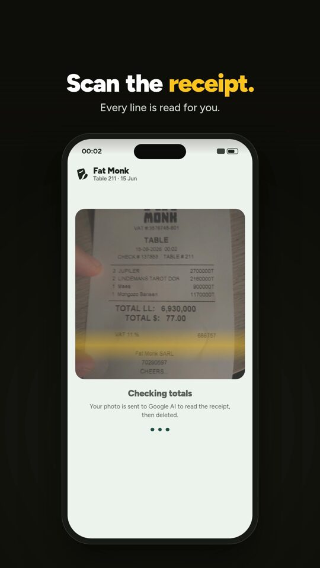
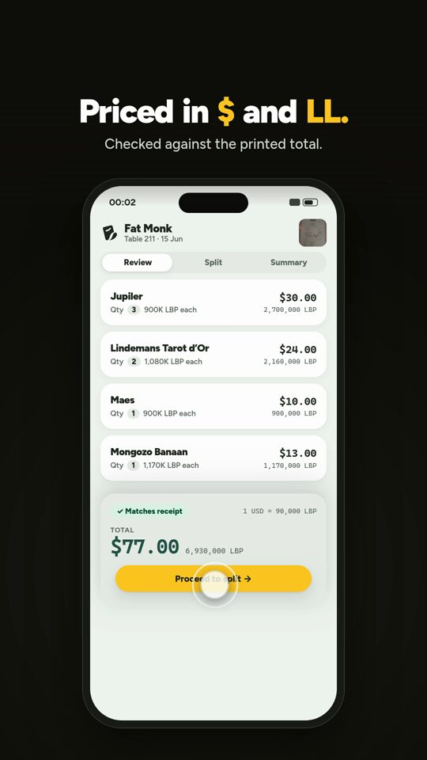
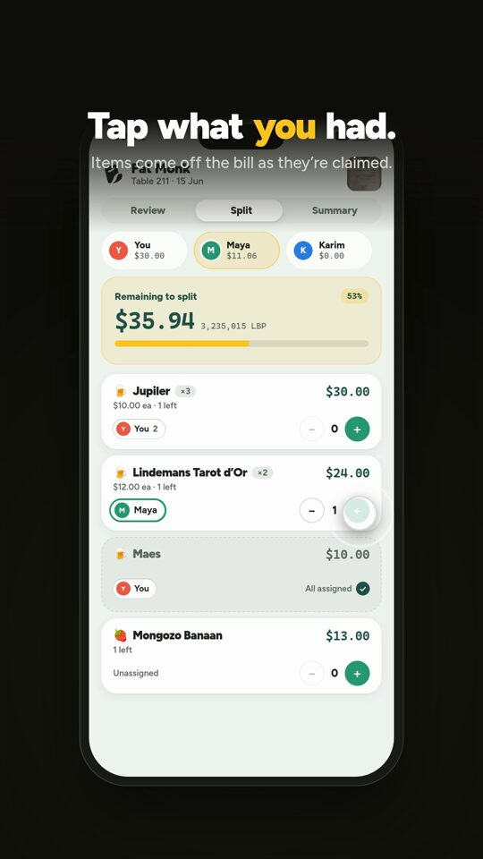
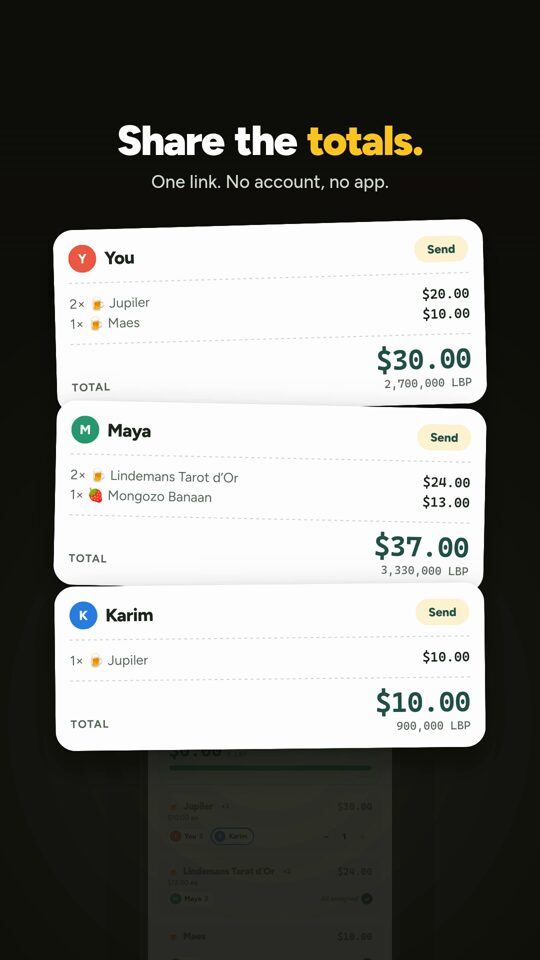

# Spolio

A mobile-first receipt splitter for Lebanon's dual-currency reality: scan a
receipt, split it item by item, and share per-person totals in LBP and USD.

Live at [spolio.net](https://spolio.net). No account needed.

## Screenshots

<p align="center">
  
  
  
  
</p>

## How it works

1. **Scan.** Take a photo of the receipt. The image is compressed in the
   browser, uploaded to Convex storage, and sent to Google Gemini for
   extraction. The image is deleted once extraction finishes.
2. **Review.** The extracted line items, service charge, tax and printed totals
   are shown as an editable bill. Items are checked against the printed total,
   and the LBP/USD rate is derived from the receipt itself when it prints both
   totals.
3. **Split.** Add people and assign individual units of each item to them, or
   share an item evenly. Service and tax are distributed proportionally.
4. **Share.** Publish a live share link or QR code. Friends open it in the
   browser, join the table, claim their items, and see their totals in both
   currencies update in real time.

Each bill is one Convex document holding its metadata, line items and people;
claims live in their own table because they are the high-churn part of a live
split. Edits are local-first and saved with a debounced mutation, and every
open screen updates over the Convex WebSocket. See
[`docs/architecture-decision.md`](./docs/architecture-decision.md) for the
reasoning.

## Tech stack

- [TanStack Start](https://tanstack.com/start) and TanStack Router for routes,
  SSR and the app shell
- [TanStack Query](https://tanstack.com/query) with `@convex-dev/react-query`
  for live Convex queries
- [Convex](https://convex.dev) for the reactive backend, file storage and
  extraction actions, with `convex-helpers`, `@convex-dev/action-retrier` and
  `@convex-dev/rate-limiter`
- [Tailwind CSS](https://tailwindcss.com) v4, Base UI, shadcn and Motion for the UI
- Zod, `browser-image-compression` and `qrcode.react`
- Sentry for error reporting (optional)
- Vite, deployed to [Cloudflare Workers](https://workers.cloudflare.com) with
  Wrangler
- Vitest and `convex-test` for tests

## Getting started

Prerequisites:

- Node.js 22 or newer and [pnpm](https://pnpm.io)
- A [Convex](https://convex.dev) account
- For receipt scanning: a Google Gemini API key and a
  [Cloudflare AI Gateway](https://developers.cloudflare.com/ai-gateway/)
  (extraction requests are routed through the gateway). Manual bill entry works
  without these.

```sh
pnpm install
cp .env.local.example .env.local

# Log in to Convex, create a dev deployment and push the functions.
# This also writes the deployment URL into .env.local.
pnpm exec convex dev --once

# Configure extraction on the Convex deployment.
pnpm exec convex env set GEMINI_API_KEY <your-gemini-api-key>
pnpm exec convex env set CF_AIG_ACCOUNT_ID <your-cloudflare-account-id>
pnpm exec convex env set CF_AIG_GATEWAY <your-ai-gateway-name>

# Start the web app and the Convex dev watcher together.
pnpm dev
```

Optional Convex environment variables read by the backend:

- `GEMINI_MODEL`: the Gemini model to use (defaults to `gemini-2.5-flash-lite`).
- `CF_AIG_TOKEN`: use a key stored in the AI Gateway instead of
  `GEMINI_API_KEY`.
- `EXTRACTION_DISABLED`: set to any value to turn off receipt extraction.

`VITE_CLOUDFLARE_WEB_ANALYTICS_TOKEN` and `VITE_SENTRY_DSN` in `.env.local` are
optional; leave them blank to disable those services.

## Scripts

| Script | What it does |
| --- | --- |
| `pnpm dev` | Pushes Convex functions once, then runs the Vite dev server and `convex dev` together |
| `pnpm dev:web` | Vite dev server only |
| `pnpm dev:db` | `convex dev` watcher only |
| `pnpm build` | Production Vite build, then `tsc --noEmit` |
| `pnpm preview` | Preview the production build locally |
| `pnpm test` | Run the Vitest suite (unit tests and Convex function tests) |
| `pnpm brand:export` | Regenerate brand assets from `brand/` sources |
| `pnpm cf-typegen` | Generate Cloudflare Worker types with Wrangler |
| `pnpm deploy` | Build and deploy the web app to Cloudflare Workers |

## Project structure

```text
brand/          Brand sources, logo kit and asset export notes
convex/         Backend: schema, bill functions, extraction pipeline
docs/           Design and architecture documents
public/         Static assets, icons and web manifest
scripts/        Brand asset export script
src/            Frontend app
test/           Vitest suites for src/lib and Convex functions
```

Inside `src/`:

- `routes/`: thin TanStack Router file routes (landing/scan, review, split,
  summary, guest join, privacy, terms)
- `components/features/`: the user-facing pages for each step of the flow
- `api/`: the only place the frontend references Convex functions
- `hooks/`: React hooks, including `useBillEditor`, the local-first editor
- `lib/`: framework-free logic (`bill/`, `money/`, `format/`, `session/`)

Inside `convex/`:

- `schema.ts`: the source of truth for stored data
- `bills/host/` and `bills/guest/`: the public API, split by caller
- `bills/lib/`: custom function builders and shared validators
- `model/`: plain TypeScript helpers called by the public functions
- `extraction/`: the receipt image to JSON pipeline (prompt, provider call,
  action)

A good reading order is `convex/schema.ts`, `src/lib/types.ts`, `src/api/`,
`src/hooks/useBillEditor.ts`, then the feature pages and the matching Convex
functions. [`convex/README.md`](./convex/README.md) describes the backend
layout and conventions in detail.

## Deploying

1. Deploy the backend: `pnpm exec convex deploy`, and set the same Convex
   environment variables on the production deployment.
2. Set `VITE_CONVEX_URL` to the production Convex URL for the build.
3. Deploy the frontend: `pnpm deploy`, which builds and runs `wrangler deploy`.

`wrangler.jsonc` contains the Worker name, Cloudflare account and custom domain
used by spolio.net. Replace them with your own before deploying a fork.

## Design docs

- [`docs/receipt-splitter-build-spec.md`](./docs/receipt-splitter-build-spec.md):
  product logic, extraction pipeline, currency and split math
- [`docs/architecture-decision.md`](./docs/architecture-decision.md): how bills
  are stored and edited, and why
- [`docs/ui-flow-vision.md`](./docs/ui-flow-vision.md): how the app should feel
- [`docs/ux-flow-and-motion-plan.md`](./docs/ux-flow-and-motion-plan.md): the
  continuous-surface flow and motion design
- [`docs/realtime-validation.md`](./docs/realtime-validation.md): validation
  notes for shared live sessions
- [`brand/README.md`](./brand/README.md): brand colors, motion and asset export

## Contributing

Issues and pull requests are welcome. Before opening a pull request, run
`pnpm test` and `pnpm build` (which also type-checks) and make sure both pass.

By contributing, you agree that your contributions are licensed under
AGPL-3.0-only.

## License

Copyright (C) 2026 Charbel Tannous. Licensed under the GNU AGPL v3.0 only;
see [LICENSE](./LICENSE).

If you use or fork this project, please credit the original with a link to
https://spolio.net. If you run a modified version as a network service, you
must publish its source under the same license.

## Trademark

The Spolio name, logo and brand assets (`brand/`, `public/brand-*`, app icons
and favicons, `og-image`) are not licensed under the AGPL. Forks must use their
own name and branding.

## Credits

Spolio started from the
[TanStack Start Convex example (`convex-trellaux`)](https://github.com/TanStack/router/tree/main/examples/react/start-convex-trellaux)
by TanStack, licensed under the MIT License.
