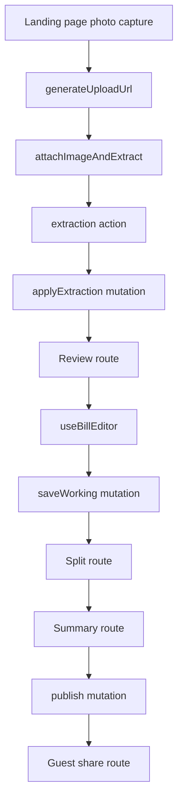

# Receipt Splitter

A mobile-first receipt splitter for Lebanon's dual-currency reality. The app
lets someone scan a receipt, review the extracted line items, split individual
units between people, and publish a live share link with per-person totals in
LBP and USD.

Consumer launch plan: see [`docs/launch-plan.md`](./docs/launch-plan.md) — September 15 launch
scope, readiness gates, production verification, and launch follow-up.
Current assessment: [`docs/launch-readiness-review.md`](./docs/launch-readiness-review.md) —
September 9 findings, confirmed blockers, verification gaps, and announcement readiness.
The older [`docs/ROADMAP.md`](./docs/ROADMAP.md) covers venue-product ideas and background;
the consumer launch plan takes precedence for this release.
Deeper product ideas and pitch material: [`docs/IDEAS.md`](./docs/IDEAS.md).
Brand assets, colors, motion, and export instructions: [`brand/README.md`](./brand/README.md).

Project plans, specifications, and design notes live in [`docs/`](./docs/).

The app uses:

- TanStack Start for routes, SSR, and app shell.
- TanStack Query with `@convex-dev/react-query` for live Convex queries.
- Convex for the reactive backend, storage, mutations, and extraction actions.
- Tailwind CSS for styling.

## Commands

```sh
pnpm install
pnpm dev
pnpm build
```

`pnpm build` runs the production Vite build and `tsc --noEmit`.

For Convex development, use:

```sh
npx convex dev
```

Do not use `npx convex deploy` for local development.

## Mental Model

Each bill is one `bills` document in Convex containing the bill metadata, line
items, and people as bounded arrays; **claims live in their own `claims` table**
(one row per (item, person) pair, `by_bill` index) because they are the
high-churn part of a live split (see `docs/architecture-decision.md` §Revisited).
Queries assemble `{ ...bill, claims }`, so the frontend still sees one bill
object. Editing items/people/meta is local-first: the browser owns a working
copy while it is dirty, then flushes it with a debounced `saveWorking` mutation.
Claims are written only through the scoped claim mutations as row diffs.



Convex queries are live. After any mutation changes a bill, all routes using
that bill query update over the Convex WebSocket without polling or manual query
invalidation.

## How To Read The Code

Start with the shape, then the client flow, then the backend flow:

1. `convex/schema.ts`: the stored bill document shape.
2. `src/lib/types.ts`: shared line item, person, claim, status, and extraction types.
3. `src/api/`: the frontend's Convex query and mutation entry points.
4. `src/hooks/useBillEditor.ts`: the local-first editor coordinator.
5. `src/lib/bill/*`: pure editor helpers used by the hook and backend.
6. `src/components/features/review/ReviewPage.tsx`,
   `src/components/features/split/SplitPage.tsx`, and
   `src/components/features/summary/SummaryPage.tsx`: the user-facing workflow.
7. `convex/bills/host/*` and `convex/bills/guest/*`: bill queries, mutations,
   uploads, and extraction persistence.
8. `convex/extraction/*`: the image-to-JSON vision model pipeline.

## Frontend File Guide

### Routes

Routes are thin: each one wires `createFileRoute` (+ loader) to a feature page
under `src/components/features/`.

- `src/routes/index.tsx`: renders the landing page. Its scan button opens the
  photo picker directly; `ScanReceiptActions` previews the photo, then creates
  a bill, uploads it, and starts extraction. Manual entry and recent bills are
  also available here; there is no separate `/scan` page.
- `src/routes/review/$billId.tsx`: review screen for editing merchant metadata,
  printed totals, service/tax, and receipt lines (renders `ReviewPage`).
- `src/routes/split/$billId.tsx`: split screen where people claim item units
  (renders `SplitPage`).
- `src/routes/summary/$billId.tsx`: owner summary screen that computes totals
  and publishes/copies the share link (renders `SummaryPage`).
- `src/routes/join/$shareToken.tsx`: read-only/participating guest view for a
  published share link (renders `JoinPage`).

### Query And Editor Wiring

- `src/api/`: the only place that touches `convex/_generated/api`.
  `billQueries.ts` has option factories for reads (`billQueries.detail(id)`,
  `billQueries.byToken(shareToken)`), used with `convexQuery(...)`.
  `billMutations.ts` and `uploads.ts` wrap `useConvexMutation` in TanStack
  Query `useMutation` hooks. Import from `~/api`; a Convex file rename or
  function rename only ever touches this folder.
- `src/hooks/useBillEditor.ts`: React-only editor orchestration. It loads the
  server document, keeps the working copy in state/refs, persists to
  localStorage, schedules debounced saves, flushes on page hide/unmount, and
  exposes edit methods to routes.

### Shared Bill Domain Helpers (`src/lib/bill/`)

Grouped module with a barrel `index.ts`; import `~/lib/bill` from outside the
folder.

- `types.ts`: working editor types: `WorkingMeta`, `WorkingBill`, and
  `BillEditor`.
- `constants.ts`: shared bill constants such as person colors, default person
  color, low-confidence threshold, save delay, and default person name.
- `ids.ts`: UUID-based IDs for in-document bill entities, share token
  generation, and round-robin person colors.
- `working.ts`: maps a Convex bill document into the nested `WorkingBill`
  shape used by the editor, sanitizes local working copies before saving, and
  validates localStorage payloads.
- `storage.ts`: localStorage read/write/clear helpers for dirty working bills.
- `edits.ts`: pure immutable transforms for editing metadata, adding/
  updating/removing line items and people, plus `reconcileClaims` (used
  server-side by `saveWorking` to drop/scale claim rows after item edits).
- `claims.ts`, `status.ts`, `itemEmoji.ts`: claim helpers, status-lifecycle
  helpers, and item emoji lookup.

### Shared Math And Formatting

- `src/lib/money/` (barrel `index.ts`): `currency.ts` (default LBP/USD rate,
  venue-rate derivation from printed totals, currency conversion, and
  LBP/USD formatting), `reconcile.ts` (arithmetic checksum used to compare
  item totals against the printed receipt total), `split.ts` (pure split math
  for effective unit price, remaining units, per-person claimed lines,
  service/tax distribution, and final portfolios). Imported by both the
  browser and Convex — kept pure, no React.
- `src/lib/format/` (barrel `index.ts`): `number.ts` (numeric input parsing
  for receipt fields), `format.ts` (shared unit formatting for fractional
  claims), `shareText.ts` (share-link copy text).
- `src/lib/session/` (barrel `index.ts`): `deviceId.ts`, `guestSession.ts`,
  `billHistory.ts` — device/guest-session identity and the localStorage
  recent-scans list.
- `src/lib/ui/` (barrel `index.ts`): `animations.ts` (motion presets),
  `haptics.ts`, `theme.ts`, `appContent.ts`.
- `src/lib/types.ts`, `src/lib/utils.ts`, `src/lib/invariant.ts`,
  `src/lib/seo.ts`: root-level canonical domain types, `cn()`, assertion
  helper, and SEO meta helpers.

### Bill Components (`src/components/features/bill/`)

Bill-domain components used by two or more features, grouped into five
clusters, each with its own barrel `index.ts`; the folder's top `index.ts` is
the surface other features import (clusters never import the top barrel from
each other — they import a sibling cluster's barrel directly, to avoid
import cycles).

- `claims/`: `ClaimList.tsx`, `ClaimListItem.tsx`, `ClaimListSkeleton.tsx` —
  unit claim steppers, split-evenly action, and loading skeleton.
- `people/`: `PersonRail.tsx`, `PersonPanelRow.tsx`, `PersonBarPill.tsx`,
  `PersonAvatar.tsx`, `AddPerson.tsx` — people selector and add/remove UI.
- `receipt/`: `ReceiptLines.tsx` (editable receipt line list),
  `PortfolioReceipt.tsx` (per-person summary receipt), `ItemPrice.tsx`.
- `summary/`: `BillSummary.tsx`, `ShareSplitCard.tsx`.
- `workspace/`: `BillSplitWorkspace.tsx`, `MobileSplitSheet.tsx`,
  `SplitSheetHandle.tsx`, `SplitHero.tsx`, `WorkspaceHeader.tsx`,
  `TipControl.tsx`, `ServicePanel.tsx`.

Generic, domain-free primitives live in `src/components/ui/` instead (shadcn
primitives plus hand-rolled generics like `animated-amount.tsx` and
`blur-commit-input.tsx`).

## Convex File Guide

### Schema And Generated API

- `convex/schema.ts`: the database schema. `bills` stores metadata, image ref,
  share token, status, version, line items, and people; `claims` is a separate
  high-churn table keyed by `billId` (all access via
  `convex/model/claimRows.ts`).
- `convex/_generated/api.d.ts`: generated Convex API type map. Do not edit it
  by hand. Regenerate it with `npx convex dev --once` after moving Convex
  functions.

### Bill Functions

Public bill functions are split by **caller** then **domain** — a file's path
is its api namespace, so `convex/bills/host/lifecycle.ts` is
`api.bills.host.lifecycle.*`.

- `convex/bills/host/`: host-side functions, gated by bill id.
  - `lifecycle.ts`: `createBill`, `createDemoBill`, `saveWorking`, `publish`,
    `finalize`, `revokeShare`, `setTipPercent`.
  - `people.ts`: `addHostPerson`, `removeHostPerson`, `setHostPersonPaid`.
  - `claims.ts`: `stepHostClaim`, `shareHostItemEvenly`,
    `splitLeftoversEvenly`.
  - `queries.ts`: `getBill`.
  - `uploads.ts`: `generateUploadUrl` and `attachImageAndExtract` (the latter
    schedules the internal extraction action).
- `convex/bills/guest/`: guest-side functions, scoped by `shareToken` +
  `guestSessionId`.
  - `people.ts`: `joinSplit`, `addGuestPerson`, `setGuestPersonPaid`.
  - `claims.ts`: `stepGuestClaim`, `shareGuestItemEvenly`,
    `restoreGuestItemSplit`. Once a guest session has joined the table it can
    claim and split for anyone at the table; marking paid stays own-people-only.
  - `queries.ts`: `getBillByToken`.
- `convex/bills/extraction.ts`: internal mutations (`applyExtraction`,
  `onExtractionComplete`) that persist parsed model output into the bill
  document.
- `convex/bills/lib/`: registers **no** public functions, so it creates no api
  namespace — plumbing only.
  - `functions.ts`: custom function builders (convex-helpers
    `customMutation`/`customQuery`) that every public bills function
    registers through: `billMutation`, `editableBillMutation`,
    `settleBillMutation`, `guestMutation`, `guestSettleMutation`,
    `deviceLimitedMutation`, `billQuery`, `sharedBillQuery`.
  - `validators.ts`: Convex validators shared by bill functions, including
    bill return shape, editable metadata, and extracted receipt payloads.

### Model (`convex/model/`)

Plain-TS helpers with no registered functions; public functions are thin
wrappers that call into these.

- `bills.ts`: gates and validation (`assertEditableSplit`, `assertSettleOpen`,
  `assertSharedForGuestWrites`, …), plus claim math (`saveClaimsForPerson`).
- `claimRows.ts`: the claims-table seam — read, wire mapping, and keyed
  row-diff sync. All claim-row access goes through here.

### Extraction Pipeline

- `convex/extraction/actions.ts`: internal action that reads the uploaded image,
  calls the vision provider, persists extraction results, and deletes the image
  best-effort.
- `convex/extraction/vision.ts`: swappable Cloudflare AI Gateway/Gemini provider
  call. It encodes image bytes, sends the prompt, strips JSON fences, and parses
  the response.
- `convex/extraction/prompt.ts`: the receipt extraction prompt and JSON contract.

### Convex Helpers

- `convex/lib/imageStore.ts`: storage seam for upload URL generation, image read,
  and image deletion.
- `convex/lib/invariant.ts`: small assertion helper for missing documents or
  required configuration.
- `convex/lib/rateLimits.ts`: per-device rate limiter configuration consumed
  by `deviceLimitedMutation`.
- `convex/lib/retrier.ts`: `@convex-dev/action-retrier` wiring for the
  extraction action's retry/backoff behavior.
- `convex/crons.ts`: placeholder for scheduled backend work such as FX refreshes
  or image TTL cleanup.

## Main Flows

### Create And Extract

1. The scan route calls `useCreateBill()`.
2. The client asks Convex for an upload URL through
   `api.bills.host.uploads.generateUploadUrl`.
3. The client uploads image bytes to Convex storage.
4. The client calls `api.bills.host.uploads.attachImageAndExtract`.
5. Convex schedules `internal.extraction.actions.extractReceipt`.
6. The action reads the image, calls the vision model, then calls
   `internal.bills.extraction.applyExtraction`.
7. The bill document is updated with extracted line items and metadata.

### Review And Autosave

1. The review route loads `api.bills.host.queries.getBill`.
2. `useBillEditor` converts the flat Convex document into `WorkingBill`.
3. UI edits call pure helpers from `src/lib/bill/edits.ts`.
4. The hook mirrors dirty state to localStorage and debounces a full-document
   `saveWorking` mutation.
5. Convex pushes the updated bill back to all subscribers.

### Split And Publish

1. The split route uses the same `useBillEditor` working copy.
2. Claim actions update fractional units in local state.
3. `src/lib/money/split.ts` computes remaining units and per-person totals.
4. The summary route calls `publish`, which freezes the bill as `PUBLISHED` and
   returns the share token.
5. Guests load the read-only bill through `getBillByToken`.

## Rules Of Thumb

- Put React state and lifecycle code in hooks/routes/components.
- Put pure bill transforms in `src/lib/bill/*`.
- Put calculations that need to be shared by UI/backend in `src/lib/money/*`
  or `src/lib/types.ts`.
- Put Convex query/mutation/action wrappers in `convex/bills/<host|guest>/*`,
  registered through a builder from `convex/bills/lib/functions.ts`.
- Keep external API calls in Convex actions, not queries or mutations.
- Keep `convex/schema.ts` as the source of truth for persisted data shape.
