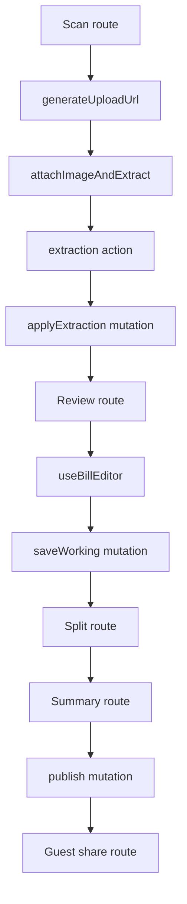

# Receipt Splitter

A mobile-first receipt splitter for Lebanon's dual-currency reality. The app
lets someone scan a receipt, review the extracted line items, split individual
units between people, and publish a live share link with per-person totals in
LBP and USD.

Production/go-to-market plan: see [`ROADMAP.md`](./ROADMAP.md) — launch blockers, the
"Billy for Venues" QR table-session product, pricing, and the Lebanon marketing plan.
Deeper product ideas and pitch material: [`IDEAS.md`](./IDEAS.md).

The app uses:

- TanStack Start for routes, SSR, and app shell.
- TanStack Query with `@convex-dev/react-query` for live Convex queries.
- Convex for the reactive backend, storage, mutations, and extraction actions.
- Tailwind CSS for styling.

## Commands

```sh
pnpm install
pnpm dev
pnpm build
```

`pnpm build` runs the production Vite build and `tsc --noEmit`.

For Convex development, use:

```sh
npx convex dev
```

Do not use `npx convex deploy` for local development.

## Mental Model

Each bill is stored as one `bills` document in Convex. The document contains the
bill metadata, line items, people, and claims as bounded arrays. Editing is
local-first: the browser owns a working copy while it is dirty, then flushes the
whole working document with a debounced `saveWorking` mutation.



Convex queries are live. After any mutation changes a bill, all routes using
that bill query update over the Convex WebSocket without polling or manual query
invalidation.

## How To Read The Code

Start with the shape, then the client flow, then the backend flow:

1. `convex/schema.ts`: the stored bill document shape.
2. `src/lib/types.ts`: shared line item, person, claim, status, and extraction types.
3. `src/queries.ts`: the frontend's Convex query and mutation entry points.
4. `src/hooks/useBillEditor.ts`: the local-first editor coordinator.
5. `src/lib/bill/*`: pure editor helpers used by the hook and backend.
6. `src/routes/review/$billId.tsx`, `src/routes/split/$billId.tsx`, and
   `src/routes/summary/$billId.tsx`: the user-facing workflow.
7. `convex/bills/*`: bill queries, mutations, uploads, and extraction persistence.
8. `convex/extraction/*`: the image-to-JSON vision model pipeline.

## Frontend File Guide

### Routes

- `src/routes/scan.tsx`: creates a bill, compresses/uploads the receipt image,
  and starts extraction.
- `src/routes/review/$billId.tsx`: review screen for editing merchant metadata,
  printed totals, service/tax, and receipt lines.
- `src/routes/split/$billId.tsx`: split screen where people claim item units.
- `src/routes/summary/$billId.tsx`: owner summary screen that computes totals and
  publishes/copies the share link.
- `src/routes/join/$shareToken.tsx`: read-only guest view for a published share link.

### Query And Editor Wiring

- `src/queries.ts`: one place for frontend Convex references. Reads use
  `convexQuery(api.bills.queries.*)`. Writes use `useConvexMutation` wrapped in
  TanStack Query `useMutation`.
- `src/hooks/useBillEditor.ts`: React-only editor orchestration. It loads the
  server document, keeps the working copy in state/refs, persists to
  localStorage, schedules debounced saves, flushes on page hide/unmount, and
  exposes edit methods to routes.

### Shared Bill Domain Helpers

- `src/lib/bill/types.ts`: working editor types: `WorkingMeta`, `WorkingBill`,
  and `BillEditor`.
- `src/lib/bill/constants.ts`: shared bill constants such as person colors,
  default person color, low-confidence threshold, save delay, and default person
  name.
- `src/lib/bill/ids.ts`: UUID-based IDs for in-document bill entities, share
  token generation, and round-robin person colors.
- `src/lib/bill/working.ts`: maps a Convex bill document into the nested
  `WorkingBill` shape used by the editor, sanitizes local working copies before
  saving, and validates localStorage payloads.
- `src/lib/bill/storage.ts`: localStorage read/write/clear helpers for dirty
  working bills.
- `src/lib/bill/edits.ts`: pure immutable transforms for editing metadata,
  adding/updating/removing line items and people, setting/stepping claims,
  splitting an item evenly, and reconciling claims after deletes or quantity
  changes.

### Shared Math And Formatting

- `src/lib/currency.ts`: default LBP/USD rate, venue-rate derivation from printed
  totals, currency conversion, and LBP/USD formatting.
- `src/lib/reconcile.ts`: arithmetic checksum used to compare item totals against
  the printed receipt total.
- `src/lib/split.ts`: pure split math for effective unit price, remaining units,
  per-person claimed lines, service/tax distribution, and final portfolios.
- `src/lib/number.ts`: numeric input parsing for receipt fields.
- `src/lib/format.ts`: shared unit formatting for fractional claims.

### Bill Components

- `src/components/bill/BlurCommitInput.tsx`: reusable input that keeps a local
  draft and commits only on blur.
- `src/components/bill/ReceiptLines.tsx`: editable receipt line list.
- `src/components/bill/ServicePanel.tsx`: service/tax toggle and values.
- `src/components/bill/PersonRail.tsx`: people selector and add/remove UI.
- `src/components/bill/ClaimList.tsx`: unit claim steppers and split-evenly action.
- `src/components/bill/RemainingBar.tsx`: remaining unclaimed amount display.
- `src/components/bill/PortfolioReceipt.tsx`: per-person summary receipt.
- `src/components/bill/AnimatedAmount.tsx`: animated numeric amount display.

## Convex File Guide

### Schema And Generated API

- `convex/schema.ts`: the database schema. The important table is `bills`, which
  stores metadata, image ref, share token, status, version, line items, people,
  and claims.
- `convex/_generated/api.d.ts`: generated Convex API type map. Do not edit it by
  hand. Regenerate it with `npx convex dev --once` after moving Convex functions.

### Bill Functions

- `convex/bills/queries.ts`: public read functions:
  `api.bills.queries.getBill` and `api.bills.queries.getBillByToken`.
- `convex/bills/mutations.ts`: public bill mutations:
  `createBill`, `saveWorking`, and `publish`.
- `convex/bills/uploads.ts`: public upload orchestration:
  `generateUploadUrl` and `attachImageAndExtract`. The latter schedules the
  internal extraction action.
- `convex/bills/extraction.ts`: internal mutation that persists parsed model
  output into the bill document.
- `convex/bills/validators.ts`: Convex validators shared by bill functions,
  including bill return shape, editable metadata, and extracted receipt payloads.

### Extraction Pipeline

- `convex/extraction/actions.ts`: internal action that reads the uploaded image,
  calls the vision provider, persists extraction results, and deletes the image
  best-effort.
- `convex/extraction/vision.ts`: swappable Cloudflare AI Gateway/Gemini provider
  call. It encodes image bytes, sends the prompt, strips JSON fences, and parses
  the response.
- `convex/extraction/prompt.ts`: the receipt extraction prompt and JSON contract.

### Convex Helpers

- `convex/lib/imageStore.ts`: storage seam for upload URL generation, image read,
  and image deletion.
- `convex/lib/invariant.ts`: small assertion helper for missing documents or
  required configuration.
- `convex/crons.ts`: placeholder for scheduled backend work such as FX refreshes
  or image TTL cleanup.

## Main Flows

### Create And Extract

1. The scan route calls `useCreateBill()`.
2. The client asks Convex for an upload URL through
   `api.bills.uploads.generateUploadUrl`.
3. The client uploads image bytes to Convex storage.
4. The client calls `api.bills.uploads.attachImageAndExtract`.
5. Convex schedules `internal.extraction.actions.extractReceipt`.
6. The action reads the image, calls the vision model, then calls
   `internal.bills.extraction.applyExtraction`.
7. The bill document is updated with extracted line items and metadata.

### Review And Autosave

1. The review route loads `api.bills.queries.getBill`.
2. `useBillEditor` converts the flat Convex document into `WorkingBill`.
3. UI edits call pure helpers from `src/lib/bill/edits.ts`.
4. The hook mirrors dirty state to localStorage and debounces a full-document
   `saveWorking` mutation.
5. Convex pushes the updated bill back to all subscribers.

### Split And Publish

1. The split route uses the same `useBillEditor` working copy.
2. Claim actions update fractional units in local state.
3. `src/lib/split.ts` computes remaining units and per-person totals.
4. The summary route calls `publish`, which freezes the bill as `PUBLISHED` and
   returns the share token.
5. Guests load the read-only bill through `getBillByToken`.

## Rules Of Thumb

- Put React state and lifecycle code in hooks/routes/components.
- Put pure bill transforms in `src/lib/bill/*`.
- Put calculations that need to be shared by UI/backend in `src/lib/*`.
- Put Convex query/mutation/action wrappers in `convex/*`.
- Keep external API calls in Convex actions, not queries or mutations.
- Keep `convex/schema.ts` as the source of truth for persisted data shape.
